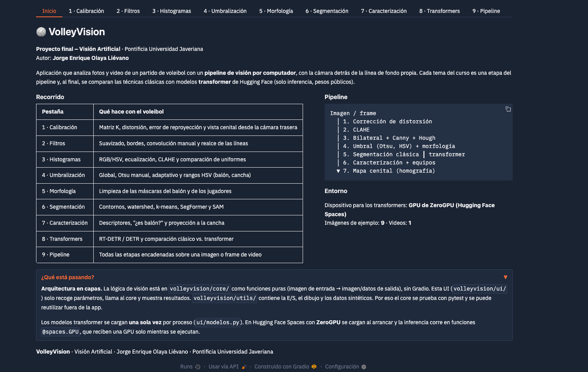
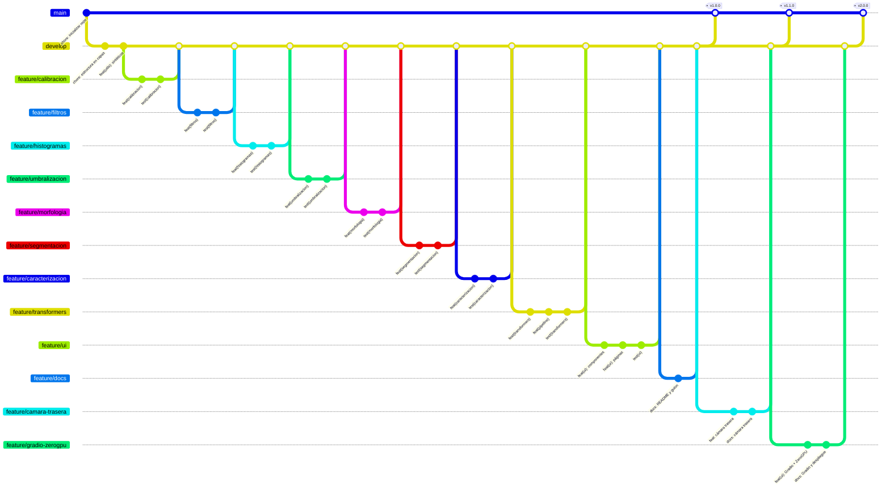
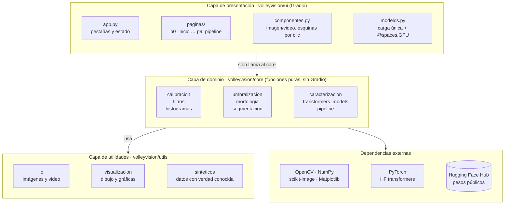
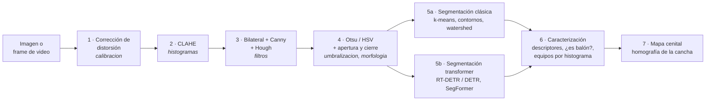

# 🏐 VolleyVision

**Proyecto final – Visión Artificial** · Ingeniería de Sistemas, Pontificia Universidad Javeriana
**Autor:** Jorge Enrique Olaya Liévano

VolleyVision analiza fotos y video de un partido de voleibol con un **pipeline de visión por computador**.
La cámara se ubica **detrás de la línea de fondo del equipo propio** (vista trasera), de modo que se
ve al equipo propio de espaldas, con el número de la camiseta visible, y al rival de frente al otro lado
de la red. Cada tema del curso es una etapa del pipeline: calibración de la cámara, filtros, histogramas,
umbralización, morfología matemática, segmentación y caracterización. Al final se comparan las técnicas
clásicas con **modelos transformer** de Hugging Face (RT-DETR, DETR, SegFormer y SAM).

> No se entrena ni se etiqueta ningún modelo: los transformers se usan **solo en inferencia** con
> pesos públicos que se descargan bajo demanda.

---

## Contenido

- [Capturas](#capturas)
- [Instalación](#instalación)
- [Cómo ejecutar](#cómo-ejecutar)
- [Despliegue en Hugging Face Spaces (ZeroGPU)](#despliegue-en-hugging-face-spaces-zerogpu)
- [Estrategia de ramificación](#estrategia-de-ramificación)
- [Arquitectura](#arquitectura)
- [Módulos](#módulos)
- [Modelos transformer](#modelos-transformer)
- [Pruebas](#pruebas)
- [Datos de ejemplo](#datos-de-ejemplo)
- [Limitaciones](#limitaciones)
- [Licencia](#licencia)

---

## Capturas

<!-- Reemplazar cada placeholder por la imagen, p. ej.:  -->

| Inicio | Calibración y homografía |
|---|---|
| _Captura pendiente: `docs/capturas/inicio.png`_ | _Captura pendiente: `docs/capturas/calibracion.png`_ |
| **Transformers (clásico vs. RT-DETR vs. DETR)** | **Pipeline completo** |
| _Captura pendiente: `docs/capturas/transformers.png`_ | _Captura pendiente: `docs/capturas/pipeline.png`_ |

> Lista de capturas sugeridas en [docs/capturas/README.md](docs/capturas/README.md).

---

## Instalación

Requisitos: **Python 3.11** y ~2 GB libres para los pesos de los modelos (se descargan la primera vez
que se usan, en la caché de Hugging Face, no en el repositorio).

```bash
git clone <url-del-repositorio> VolleyVision
cd VolleyVision

python3.11 -m venv .venv
source .venv/bin/activate          # Windows: .venv\Scripts\activate
pip install --upgrade pip
pip install -r requirements.txt
```

Funciona en **CPU**. Si hay GPU la usa automáticamente (CUDA en NVIDIA, MPS en Apple Silicon). Para
forzar un dispositivo: `export VOLLEYVISION_DEVICE=cpu`.

Datos de ejemplo (opcional):

```bash
python scripts/generar_sinteticos.py   # ya vienen en el repo; regenera tablero, cancha y video sintéticos
python scripts/download_samples.py     # descarga fotos reales con licencia libre de Wikimedia Commons
```

## Cómo ejecutar

```bash
python app.py
```

Se abre en `http://127.0.0.1:7860`. La interfaz está hecha con **Gradio** y tiene una pestaña por tema.
Recorrido sugerido: **1 · Calibración** (pulsar *Calibrar cámara* y marcar las 4 esquinas de la media
cancha propia en la subpestaña *Homografía*) → pestañas 2 a 8 → **9 · Pipeline**.

Cada pestaña tiene la carga de imagen (ejemplo, archivo propio o un frame de video), sliders para los
parámetros, el resultado al lado de la original y un desplegable **"¿Qué está pasando?"** con la teoría
y las fórmulas. Las esquinas marcadas y la calibración se guardan en la sesión y las usan las pestañas
de Caracterización y Pipeline.

## Despliegue en Hugging Face Spaces (ZeroGPU)

La app está preparada para un Space de Gradio con **ZeroGPU** (GPU compartida que se asigna solo
mientras corre una inferencia). La cabecera YAML al inicio de este README es la configuración del Space.

1. Crear el Space en <https://huggingface.co/new-space>: SDK **Gradio**, hardware **ZeroGPU**
   (requiere una cuenta PRO o de organización).
2. Subir el repositorio (la herramienta `hf` maneja sola los archivos binarios: JPG, PNG y MP4):

   ```bash
   pip install -U huggingface_hub
   hf auth login
   hf upload <usuario>/volleyvision . . --repo-type=space \
       --exclude ".venv/*" ".git/*" "**/__pycache__/*" ".pytest_cache/*" ".gradio/*"
   ```

Cómo funciona ZeroGPU en el código (`volleyvision/ui/modelos.py`):

- `app.py` importa `spaces` antes que torch y, si detecta ZeroGPU (`SPACES_ZERO_GPU`), **carga los 5
  modelos al arrancar** y los mueve a `cuda`, como exige ZeroGPU.
- La inferencia está en funciones con `@spaces.GPU` (`detectar`, `segmentar_semantica`,
  `segmentar_con_sam`, `comparar`, `pipeline_con_modelos`). Solo esas piden GPU; las técnicas clásicas
  corren en CPU y no gastan cuota.
- Cada llamada puede caer en una GPU distinta, así que los detectores se calientan dentro de la llamada
  antes de medir el tiempo.
- Fuera de ZeroGPU, `@spaces.GPU` no hace nada y los modelos se cargan la primera vez que se usan.

Los visitantes tienen una cuota diaria de GPU (mayor si inician sesión en Hugging Face). Si el Space
lleva tiempo sin visitas se duerme y la primera visita tarda en arrancar.

---

## Estrategia de ramificación

Se usa un flujo tipo **Git Flow simplificado**:

| Rama | Propósito |
|---|---|
| `main` | Versión estable y entregable. Solo recibe merges desde `develop` y se etiqueta (`v1.0.0`). |
| `develop` | Rama de integración: aquí se juntan los módulos terminados y probados. |
| `feature/<tema>` | Una rama por módulo del curso: `feature/calibracion`, `feature/filtros`, `feature/histogramas`, `feature/umbralizacion`, `feature/morfologia`, `feature/segmentacion`, `feature/caracterizacion`, `feature/transformers`, `feature/ui` (y `feature/docs` para la documentación). Los cambios posteriores siguen el mismo flujo: `feature/camara-trasera` cambió la cámara a la vista trasera (`v1.1.0`) y `feature/gradio-zerogpu` pasó la interfaz a Gradio con ZeroGPU (`v2.0.0`). |

Reglas:

1. Cada `feature/*` nace de `develop` y vuelve a `develop` con `git merge --no-ff`, para que el
   historial conserve la rama como una unidad.
2. Commits pequeños con [Conventional Commits](https://www.conventionalcommits.org/es/):
   `feat(filtros): …`, `test(umbralizacion): …`, `fix(transformers): …`, `docs: …`, `chore: …`.
3. Antes de cada merge se ejecuta `pytest` y la rama debe pasar todas las pruebas.
4. Cuando `develop` está estable se integra a `main` y se crea la etiqueta de versión.



Para ver el historial real: `git log --oneline --graph --all`.

---

## Arquitectura

### Arquitectura en capas

El código se organiza en tres capas con dependencias en un solo sentido
(**UI → core → utils**):



- **`core/`**: un módulo por tema del curso. Todas las funciones son **puras**: reciben una imagen
  (arreglo NumPy BGR `uint8`) y parámetros, y devuelven imágenes y/o datos. No importan Gradio, así
  que se prueban con `pytest` y se pueden usar desde un script o un cuaderno.
- **`ui/`**: Gradio. Solo recoge parámetros con widgets, llama al core y muestra resultados. Los
  modelos se cargan **una vez** por proceso (`ui/modelos.py`) y la inferencia va en funciones
  `@spaces.GPU` para ZeroGPU.
- **`utils/`**: E/S de imágenes y video, dibujo con la paleta del proyecto y generación de datos
  sintéticos con verdad conocida (para pruebas y demos sin internet).

### Pipeline



Cada etapa devuelve un objeto `Paso` con sus imágenes intermedias, datos y tiempo, y la pestaña
**Pipeline** los muestra todos. Más detalle en [docs/arquitectura.md](docs/arquitectura.md).

### Estructura del repositorio

```
VolleyVision/
├── volleyvision/
│   ├── core/                 # lógica de visión (funciones puras)
│   │   ├── calibracion.py    ├── filtros.py         ├── histogramas.py
│   │   ├── umbralizacion.py  ├── morfologia.py      ├── segmentacion.py
│   │   ├── caracterizacion.py├── transformers_models.py
│   │   └── pipeline.py
│   ├── ui/                   # Gradio
│   │   ├── app.py  ├── componentes.py  ├── modelos.py
│   │   └── paginas/  p0_inicio.py … p9_pipeline.py
│   └── utils/                # io.py, visualizacion.py, sinteticos.py
├── data/samples/             # cancha y video sintéticos, tablero (descargadas/ se ignora)
├── scripts/                  # generar_sinteticos.py, download_samples.py
├── tests/                    # pytest (98 pruebas)
├── docs/                     # arquitectura, guion del video, capturas
├── app.py                    # punto de entrada (local y Hugging Face Spaces)
├── requirements.txt  ├── pytest.ini  ├── LICENSE  └── README.md
```

---

## Módulos

| Módulo | Qué hace (aplicado al voleibol) | Funciones clave |
|---|---|---|
| `calibracion` | Calibración de Zhang con tablero de ajedrez (K, distorsión, error de reproyección), corrección de distorsión y homografía de la cancha desde la **cámara trasera**: con las 4 esquinas de la media cancha propia (9 × 9 m) se obtiene la homografía de todo el piso y la vista cenital de la cancha de 9 × 18 m. Modelo pinhole explicado en los docstrings. Incluye DLT propia comparada con OpenCV. | `calibrar_camara`, `corregir_distorsion`, `homografia_cancha`, `homografia_dlt`, `vista_cenital` |
| `filtros` | Promedio, gaussiano, mediana y bilateral; Sobel, Laplaciano y Canny; convolución manual (NumPy) comparada con `cv2.filter2D`; realce de las líneas de la cancha (bilateral + Canny + Hough). | `suavizar`, `sobel`, `canny`, `convolucion_manual`, `resaltar_lineas_cancha` |
| `histogramas` | Histogramas RGB/HSV, ecualización global (y manual con la CDF), CLAHE para la iluminación del coliseo y comparación H-S de uniformes con `cv2.compareHist` para asignar equipos. | `calcular_histograma`, `ecualizar_manual`, `aplicar_clahe`, `asignar_equipos` |
| `umbralizacion` | Umbral global, **Otsu implementado a mano** con la curva σ²_B(t), Otsu de OpenCV, umbral adaptativo (media y gaussiano) y rangos HSV para el balón y la cancha. | `otsu_manual`, `umbral_adaptativo`, `umbral_hsv` |
| `morfologia` | Erosión, dilatación, apertura, cierre, gradiente, top-hat y black-hat con elemento estructurante configurable; versiones manuales (mín/máx); limpieza de las máscaras del balón y los jugadores. | `elemento_estructurante`, `aplicar`, `erosion_manual`, `limpiar_mascara` |
| `segmentacion` | Contornos, watershed con transformada de distancia, k-means en color y detección clásica de jugadores (modelo de fondo + Otsu + cierre vertical). Métricas IoU. | `encontrar_contornos`, `watershed_distancia`, `kmeans_color`, `segmentar_jugadores_clasico` |
| `caracterizacion` | Área, perímetro, centroide, caja, circularidad, excentricidad, solidez y momentos de Hu; clasificador por reglas "¿es balón?"; proyección del punto de apoyo de los jugadores a la vista cenital. | `describir_region`, `detectar_balon_clasico`, `proyectar_jugadores` |
| `transformers_models` | RT-DETR / DETR (personas y `sports ball`), SegFormer (segmentación semántica), SlimSAM / SAM (segmentación por punto o caja) y la comparación clásico vs. transformer con tiempos. | `detectar_objetos`, `segmentar_semantica`, `segmentar_con_sam`, `comparar_metodos` |
| `pipeline` | Encadena las 7 etapas y devuelve el resultado de cada una. | `ejecutar_pipeline` |

---

## Modelos transformer

| Uso | Modelo | Parámetros | Enlace |
|---|---|---|---|
| Detección (por defecto) | RT-DETR R50-VD (COCO) | 42.9 M | [PekingU/rtdetr_r50vd](https://huggingface.co/PekingU/rtdetr_r50vd) |
| Detección (opcional) | DETR ResNet-50 (COCO) | 41.5 M | [facebook/detr-resnet-50](https://huggingface.co/facebook/detr-resnet-50) |
| Segmentación semántica | SegFormer-B0 (ADE20K) | 3.8 M | [nvidia/segformer-b0-finetuned-ade-512-512](https://huggingface.co/nvidia/segformer-b0-finetuned-ade-512-512) |
| Segmentación por prompt (por defecto) | SlimSAM 50 % uniforme | 28.0 M | [nielsr/slimsam-50-uniform](https://huggingface.co/nielsr/slimsam-50-uniform) |
| Segmentación por prompt (opcional) | SAM ViT-B | 93.7 M | [facebook/sam-vit-base](https://huggingface.co/facebook/sam-vit-base) |

Tiempos de referencia de la red sola, después del calentamiento, en una imagen de 960 px (Apple
Silicon con MPS): RT-DETR ≈ 90 ms, DETR ≈ 150–260 ms, SegFormer-B0 ≈ 15–55 ms, SlimSAM ≈ 0.5 s,
SAM ViT-B ≈ 0.7 s. En CPU son entre 2 y 10 veces mayores. La pestaña **8 · Transformers** mide y
compara los tiempos en tu máquina.

---

## Pruebas

```bash
pytest                 # 95 pruebas rápidas (sin descargar modelos)
pytest -m slow         # 3 pruebas que descargan y ejecutan los modelos de Hugging Face
```

Qué se verifica, entre otras cosas:

- La calibración recupera la K y la distorsión con las que se generaron las vistas sintéticas (error < 3 %).
- La proyección pinhole y la DLT manuales coinciden con `cv2.projectPoints` y `cv2.getPerspectiveTransform`.
- La convolución manual coincide con `cv2.filter2D` (diferencia < 1e-9).
- La ecualización manual y Otsu manual coinciden con `cv2.equalizeHist` y `THRESH_OTSU` (±1 nivel).
- Erosión y dilatación manuales coinciden con OpenCV; dualidad e idempotencia de la apertura.
- Watershed separa objetos que se tocan; las excentricidades coinciden con scikit-image; Hu es
  invariante a rotación y escala.
- La homografía de la media cancha ubica al equipo propio con error < 10 cm y al rival con error < 40 cm.
- El pipeline clásico encuentra ≥ 7 de los 12 jugadores sintéticos (la vista trasera tiene oclusiones),
  el balón y los dos equipos.
- La app de Gradio se construye y cada callback de la UI se ejecuta sin excepciones con la escena
  sintética (sin levantar el servidor).

---

## Datos de ejemplo

- `data/samples/cancha_sintetica*.jpg` y `rally_sintetico.mp4`: escenas sintéticas tomadas desde detrás
  de la línea de fondo propia, con posiciones conocidas (cancha naranja, zona libre verde, equipo propio
  rojo de espaldas con su número, rival azul, balón amarillo con franjas azules).
- `data/samples/tablero/`: 14 fotos sintéticas de un tablero 9 × 6 tomadas con una cámara de K y
  distorsión conocidas. `tablero_plano.png` es el patrón para imprimir.
- `data/samples/descargadas/` (no versionada): fotos reales de Wikimedia Commons con licencia libre
  (CC0, dominio público, CC BY, CC BY-SA). El script escribe `CREDITOS.md` con autor, licencia y enlace
  de cada una. El filtro es por título, así que conviene revisar las fotos y borrar las que no sean de
  un partido.

---

## Limitaciones

- **Cambio de dominio**: los jugadores sintéticos son figuras geométricas y RT-DETR/DETR detectan pocos.
  En fotos reales ocurre lo contrario: los transformers detectan bien y el método clásico confunde al
  público con jugadores.
- **Segmentación clásica de jugadores**: supone que los colores dominantes son el fondo (piso, zona
  libre, gradas). Falla con público muy colorido, jugadores superpuestos o colores parecidos al piso.
- **Oclusiones de la cámara trasera**: la primera línea propia tapa en parte a los rivales que están en
  la red. El método clásico une esas siluetas (encuentra 7–8 de 12 jugadores en las escenas sintéticas)
  y la caja unida puede quedar asignada al equipo equivocado. Una cámara elevada (tribuna o trípode alto)
  reduce el problema.
- **Balón**: los rangos HSV están pensados para balones amarillo/azul; otros colores requieren ajustar
  los sliders.
- **Homografía**: supone el piso plano y las 4 esquinas de la media cancha propia visibles (las dos de la
  línea central bajo la red y las dos de la línea de fondo propia). Los rivales se ubican con menos
  precisión porque están más lejos (cada píxel abarca más metros). Solo los puntos del piso se proyectan
  bien: un balón en el aire no se puede ubicar en el mapa cenital con una sola cámara.
- **Calibración**: el ejemplo usa un tablero sintético. Para una cámara real hay que fotografiar un
  tablero impreso con esa misma cámara y resolución.
- **Equipos**: se asume que hay dos uniformes de colores distintos; el líbero y los árbitros pueden
  quedar mal asignados.
- **Video**: se procesa frame por frame, sin seguimiento (*tracking*) entre frames.
- **Recursos**: la primera ejecución descarga unos 850 MB de pesos si se usan todos los modelos; SAM
  ViT-B es lento en CPU (por eso SlimSAM va por defecto).

---

## Licencia

[MIT](LICENSE) © 2026 Jorge Enrique Olaya Liévano. Los modelos de Hugging Face conservan sus licencias
originales (ver la ficha de cada modelo) y las fotos descargadas, las suyas (ver `CREDITOS.md`).
