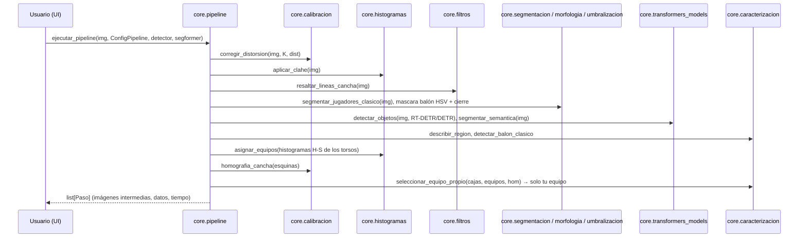

# Arquitectura de VolleyVision

## 1. Capas

| Capa | Paquete | Responsabilidad | Puede importar |
|---|---|---|---|
| Presentación | `volleyvision/ui` | Widgets de Gradio, pestañas, estado de la sesión, carga de modelos e inferencia en GPU (ZeroGPU), mostrar resultados | `core`, `utils`, `gradio`, `spaces` |
| Dominio | `volleyvision/core` | Algoritmos de visión como **funciones puras** (un módulo por tema) | `utils`, OpenCV, NumPy, scikit-image, torch, transformers |
| Utilidades | `volleyvision/utils` | E/S de imágenes y video, dibujo, datos sintéticos | OpenCV, NumPy, Matplotlib |

Las dependencias van en un solo sentido: **ui → core → utils**. Ningún archivo de `core/` importa
Gradio, y eso es lo que permite:

- probar todo el procesamiento con `pytest` sin levantar la app;
- reutilizar el core desde scripts (por ejemplo `scripts/generar_sinteticos.py`) o cuadernos;
- cambiar la interfaz sin tocar los algoritmos: la v2.0.0 pasó de Streamlit a Gradio sin modificar el core.

### Convenciones

- Las imágenes viajan como `np.ndarray` **BGR `uint8`** (el orden de OpenCV). Las máscaras son
  `uint8` con valores 0/255. La conversión a RGB se hace solo al mostrar (`utils.io.bgr_a_rgb`).
- Las funciones devuelven imágenes y/o diccionarios o *dataclasses* con datos (`ResultadoCalibracion`,
  `HomografiaCancha`, `ModeloCargado`, `Paso`).
- Los parámetros llevan valores por defecto razonables, así que la UI solo expone los que vale la pena
  explorar.

## 2. Flujo de datos del pipeline

## 3. Decisiones de diseño

| Decisión | Motivo |
|---|---|
| Fotos reales en la app; datos sintéticos solo en las pruebas (`utils/sinteticos.py`) | La app muestra fotos reales con licencia libre (con las esquinas de su media cancha guardadas). Las escenas sintéticas, con la posición exacta de cada jugador, permiten **verificar** cada algoritmo con números (K recuperada, jugadores encontrados, posiciones en metros). |
| Implementaciones manuales junto a las de OpenCV (convolución, Otsu, ecualización, erosión/dilatación, DLT, proyección pinhole) | Muestran la teoría del curso y las pruebas comparan ambas versiones. |
| RT-DETR por defecto y DETR como opción | RT-DETR es más rápido y preciso; DETR es el modelo original y sirve de referencia en la comparación de tiempos. |
| SlimSAM por defecto y SAM ViT-B como opción | SlimSAM es viable en CPU (~28 M parámetros frente a ~94 M). |
| Carga única de modelos en `ui/modelos.py` (no en el core) | El core sigue sin depender de la interfaz; la caché vive en la capa de presentación. Además se hace una inferencia de calentamiento para que la comparación de tiempos sea justa. |
| Gradio con **ZeroGPU** (Hugging Face Spaces) | ZeroGPU solo existe para Gradio. Los modelos se cargan al arrancar (requisito de ZeroGPU) y la inferencia va en funciones `@spaces.GPU`, que devuelven solo datos serializables (NumPy y diccionarios). Las técnicas clásicas corren en CPU y no gastan cuota de GPU. Fuera de un Space, `@spaces.GPU` no hace nada. |
| Modo guiado (`paginas/analizar.py`) además de las pestañas por tema | Quien no es experto solo elige una imagen y pulsa «Analizar»: por debajo corre el mismo `ejecutar_pipeline` con valores por defecto, y el resultado se resume en lenguaje sencillo. Las pestañas por tema siguen disponibles (lo pide la materia), con los parámetros secundarios en «Opciones avanzadas». |
| Estado de la sesión en un `gr.State` | Las esquinas marcadas (por escena) y la calibración se comparten entre pestañas sin variables globales, así cada visitante tiene las suyas. |
| Selección automática de dispositivo (`cuda` → `mps` → `cpu`) y sincronización antes de medir | Los tiempos en GPU son asíncronos; sin sincronizar se medirían mal. En MPS se convierten las entradas float64 a float32. |
| Punto de apoyo (centro inferior de la caja) para el mapa cenital | La homografía solo es válida para puntos del plano del piso. |
| **Solo el equipo propio** (`seleccionar_equipo_propio`) | Desde atrás el rival queda lejos, pequeño y tapado por la red: analizarlo daría resultados poco fiables. Con las esquinas, son propios los que pisan la media cancha propia (y ≥ 9 m); sin ellas, el grupo de camisetas más cercano a la cámara. El mapa muestra solo la media cancha propia. |
| Homografía a partir de la **media cancha propia** (cámara trasera) | Desde detrás de la línea de fondo se ven bien las 4 esquinas de la media cancha propia; la homografía resultante vale para todo el plano del piso, y permite decidir quién está en la media cancha propia. Coordenadas: x de 0 a 9 m (izquierda → derecha), y de 0 m (fondo rival) a 18 m (fondo propio). |
| Páginas con prefijo `pN_` (`p8_transformers.py`) | Ordenan las pestañas y evitan que un módulo llamado `transformers.py` se confunda con la librería `transformers`. |

## 4. Pruebas

| Archivo | Cubre |
|---|---|
| `tests/test_calibracion.py` | Recuperación de K y distorsión, pinhole y DLT manuales, proyección de jugadores, corrección de rectas |
| `tests/test_filtros.py` | Convolución manual = `filter2D` (7 kernels, color, asimétricos), mediana vs. promedio, Hough |
| `tests/test_histogramas.py` | Histograma y ecualización manuales, CLAHE, separación de equipos |
| `tests/test_umbralizacion.py` | Otsu manual vs. OpenCV, HSV del balón, rango circular, adaptativo vs. global |
| `tests/test_morfologia.py` | Erosión/dilatación manuales, dualidad, idempotencia, limpieza de la máscara del balón |
| `tests/test_segmentacion.py` | Contornos, watershed, k-means, jugadores clásicos, IoU |
| `tests/test_caracterizacion.py` | Descriptores vs. scikit-image, invariancia de Hu, clasificación del balón, proyección, selección del equipo propio |
| `tests/test_transformers.py` | Pipeline completo, con calibración y sin esquinas; modelos reales (`-m slow`) |
| `tests/test_reales.py` | Fotos reales de ejemplo: esquinas guardadas válidas y pipeline que se queda solo con el equipo propio |
| `tests/test_ui.py` | La app de Gradio se construye y cada callback de la UI corre sin excepciones (calibración, esquinas, pipeline); modelos reales con `-m slow` |
